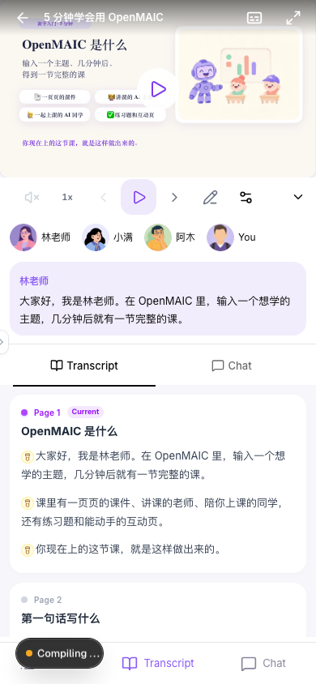
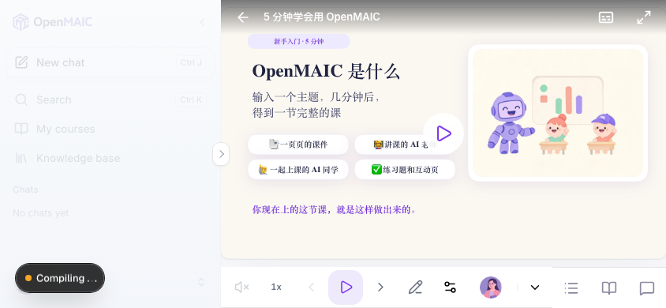
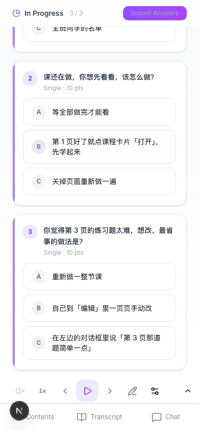
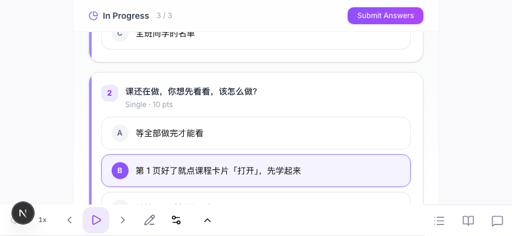
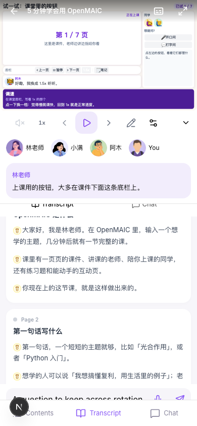
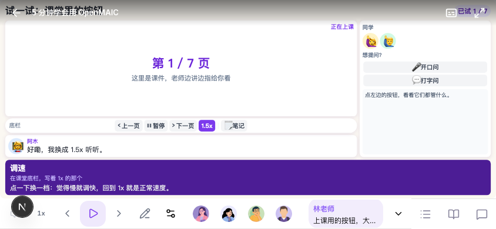
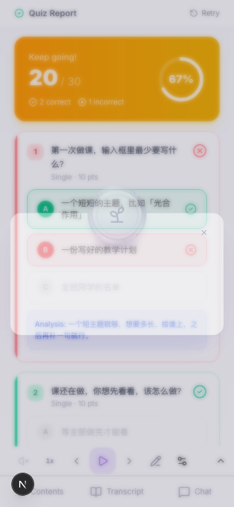
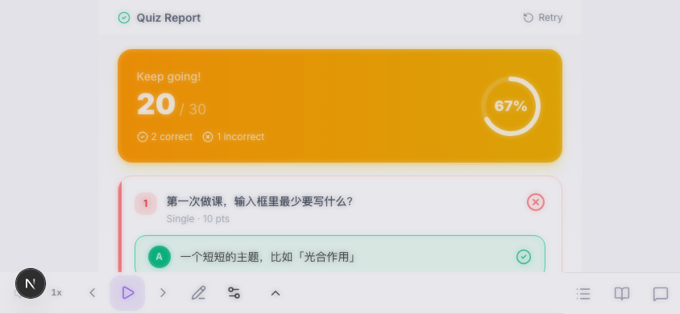

# Shared classroom phone layout

Screenshots are from the actual upstream React classroom rendering the built-in `public/guide-course/zh.json` course. They are not the HTML prototype, a fresh model-generated course, or physical-device screenshots. Chromium uses a touch-enabled mobile context, a 390×844 portrait viewport and an 844×390 landscape viewport.

| State | Portrait | Landscape |
| --- | --- | --- |
| Course opened inside the workspace |  |  |
| Actual QuizView answers |  |  |
| Actual interactive iframe, after using its speed control |  |  |
| Shared CourseEnd after answering two of three correctly |  |  |

## Architecture

`PlaybackChromeRoot` remains the owner of engines and callbacks. `Roundtable` renders touch controls using its existing speech, input, recording, suggested-reply and discussion state; its one mobile composer is portaled to a stable `ChatArea` footer. The same `SceneSidebar`, `ChatArea`, `CanvasArea`, pooled iframe host and `CourseEnd` remain in use. The iframe portal stays in the same Stage container on mobile fullscreen and rotation; no phone-specific engine, store, scoring or conversation backend is added.

The existing adaptive UA hint/media query and visible viewport hook are reused. Short viewports constrain the canvas and roundtable while keeping the composer and navigation reachable. This is geometry handling, not keyboard detection or proof of physical keyboard behavior. Desktop collapse and zoom preferences are not overwritten. PBL shows a desktop-only notice on phones; workspace courses stay in Learn mode without rewriting their saved desktop editing preference.

## Automated evidence

- `MOBILE_WORKSPACE_E2E=true pnpm exec playwright test e2e/tests/mobile-classroom.spec.ts e2e/tests/course-end.spec.ts --workers=1`: 3 passed with workbench and agent-runtime flags enabled.
- Includes portrait widths 360/390/430, landscape widths 480/568/844/932, a 390×400 short portrait viewport, viewport bounds/touch control sizes, fold/unfold, actual iframe interaction, iframe identity and internal state across rotation/panels/native fullscreen, participant modal inside fullscreen, draft preservation, quiz submission yielding 2/3, dynamic completion actions and workspace Back.
- Related classroom/playback/chat/whiteboard unit suites: 299 passed across 28 files.
- Legacy classroom/editor regression configuration: 6 browser cases passed (course completion, interactive fullscreen clipping, editor toggle/scene switching, and phone classroom); the workspace-specific case is intentionally skipped in that configuration and passes in the separate workbench-enabled run above.
- TypeScript, changed-file formatting, source ESLint and 12-locale key alignment passed. Source ESLint retains the existing Roundtable shortcut-effect dependency warning. Repository-wide ESLint also passed with existing warnings.
- Model capability settings in browser tests are mocked by the existing fixture. No real AI conversation, microphone permission/recording, streamed model response or course generation was exercised. Screenshots use real built-in course content and rendering, not mock scene cards.

## Before merge

Keep this change in Draft until iOS Safari, Android Chrome and WeChat physical-device validation is recorded, including keyboard/IME, browser toolbars, safe areas, touch scrolling, microphone/TTS and audio continuity. Native direction lock is best-effort and unsupported-browser behavior still needs device checks. Arbitrary generated GenUI content is not covered by this one course.

`CourseEnd` is deliberately reused without overriding its actions. At the implementation baseline it has dynamic `doQuiz` / `reviewWrong` / `restart` actions but no feedback-card implementation; this change does not introduce a separate mobile feedback card.
