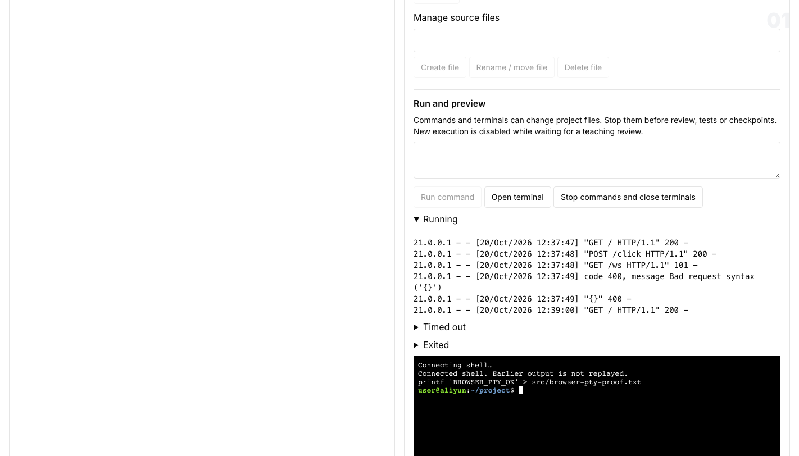

# Live provider acceptance — 2026-10-20

This run used the actual application, PostgreSQL, DeepSeek teaching model, Aliyun
E2B-compatible code template and S3-compatible checkpoint storage. No model,
provider, application route or preview response was mocked in the live checks below.
Earlier fixture/contract tests remain separate evidence.

## Installation

- Code template: `x0o9qjzrmonihabtnqbz`; desktop disabled.
- Connection: `cosarah-aliyun-economy`; lifetime 300000 ms; installation/owner limits 1/1.
- Explicit local single-user owner; application on port 1964, isolated native preview
  gateway on 1965, isolated PostgreSQL on 55464.
- Credentials stay in ignored local environment files and sealed settings. They are
  absent from this report, screenshots, course files and scene data.

## Workbench results

| Check | Observed result |
| --- | --- |
| Settings | Official settings API reported provider, preview and checkpoint configured |
| Allocation | Real private Aliyun sandbox created and project seeded |
| File operations | Create/read/rename/delete passed; stale hash refused with 409 |
| Stage boundary | Execution before coding refused with 409 |
| Generic API boundary | Generic learning-workspace mutation refused with `PBL_WORKSPACE_MANAGED` |
| Commands | Cloud command exited 0 with `PR1964_EXEC_OK`; `/usr/bin/javac` present |
| Terminal | Actual PTY create/resize/input and authenticated SSE output passed |
| Preview | Isolated gateway HTTP GET/POST and WebSocket echo passed |
| Browser | Independent Chromium opened the real classroom and cloud iframe, submitted a real cloud POST, typed into xterm, and verified the resulting file through the host API |
| Stop | Browser stopped managed commands and closed terminals; preview and terminal UI closed |
| Checkpoint safety | Active managed writer blocked checkpoint with `WORKSPACE_COMMAND_ACTIVE` |
| Durable save | Actual storage upload reached checkpoint revision 3 (10240 bytes) |
| Quota | A second allocation was refused with 429 at maxActive=1 |
| Provider loss | Only this study’s owned provider resource was killed after metadata/owner verification |
| Recovery | Prepare allocated a new resource and restored checkpoint 3; all 4 file texts and hashes matched; teaching progress retained |
| Stale environment | Write against the replaced environment refused with 409 |

Temporary cloud probe sources were removed through the workbench API after recovery.
The browser checkpoint assertion was supplemented by a separate durable revision
check; seeing an existing save label alone does not prove a new save.

The temporary preview probe originally used HTTP/1.0 for its WebSocket upgrade.
Correcting that probe to HTTP/1.1 with explicit response lengths made the normal
compression-enabled client pass. No gateway workaround was required.

## Teaching capability alignment

Real teaching exposed a prompt mismatch: a teacher could require source edits or new
execution while the current classroom stage allowed conceptual discussion only.
The runner now explicitly describes read-only and PLAN-only capabilities. This
preserves the normal review gates and student confirmation of progression.

## Standalone course result

The public Python course completed through real teaching turns and registered tools:
introduction → concept teaching → recorded formatting decision → PLAN.md review →
cloud source edit and code review → formal cloud test → quiz → mentor reflection →
student confirmation. Durable status is `completed` (completion revision 1). The
formal result was `2 checks passed`; quiz score was 1/1 on its first attempt.

After restarting the service with the capability prompt change, the final read-only
reflection used recorded test evidence and conceptual predictions; it did not require
new writes or execution. No `ENVIRONMENT_BUSY` error was recorded in the real
teaching event stream for this course. The focused PBL PostgreSQL regression suite
also passed: 48 tests in 6 files.

## Limits

These results cover one authorized installation and one active learner resource.
They do not establish cohort capacity, adversarial process isolation or desktop
behavior. Managed-writer safeguards do not supervise arbitrary detached children.
The five-minute lifetime is renewed while the visible classroom is active; durable
recovery uses the last successful checkpoint, not unsaved work.
