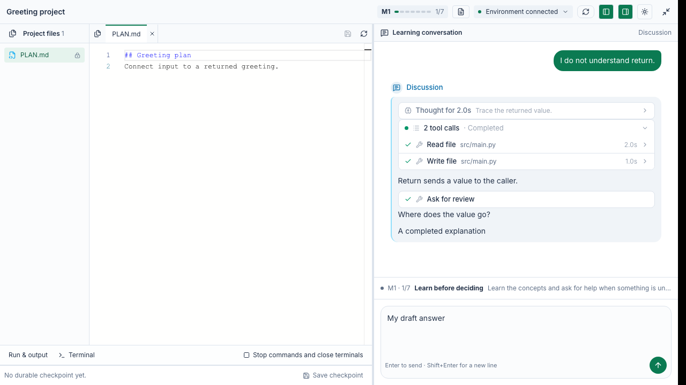
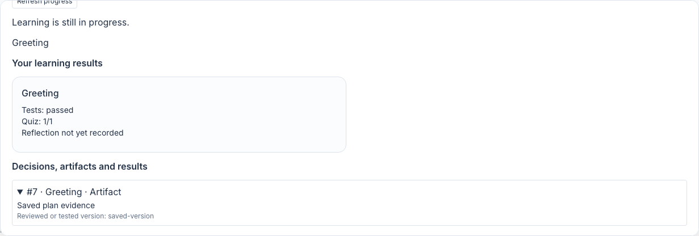

# PBL v3 learning runtime

For the dedicated classroom file, execution and recovery controls, see
[Learning workbench and recovery](WORKBENCH.md).
For self-contained `.maic.zip` delivery, see
[Project packages, permissions and verification](PROJECT-PACKAGES.md).
For the pre-course scope audit and its verification boundaries, see
[Course readiness checklist](READINESS.md).

This slice opens an installed programming project in the normal classroom, runs
four teaching roles in the existing Agent runner, and persists learning progress
in PostgreSQL. It does not enable generated v3 projects.

## Try the sample

Use the application's existing configuration:

- PostgreSQL through `DATABASE_URL`.
- `OPENMAIC_AGENT_RUNTIME_ENABLED=true` and a configured `agent` model slot.
- A configured shared sandbox provider and durable checkpoint storage.
- Explicit single-user installation mode, or a host-verified user with `sandbox:use`.

Open `/pbl-v3` and choose a Java or Python sample. The classroom first shows the
existing project Hero; Start/Continue uses the same web-fullscreen reveal as v2,
with the v3 workbench inside. Entering the project automatically prepares its hosted
environment and opens the first teaching step. There is no
learner setup click or deployment choice. Setup failure offers an explicit retry.
The configured sandbox template must have Python 3. Follow the teaching sections,
record a decision, review the plan and implementation, run and collect tests,
complete the quiz, and reflect with the mentor. Use **Continue** to confirm stage
progression. Confirming a plan or code stage also saves a durable checkpoint before
advancing. The current learner UI does not expose a manual checkpoint control.

A PBL scene selects `{ projectV3: { id, version } }`. The server resolves that
reference against installed content. The scene never supplies model credentials,
executable test commands, answers, or authoritative learning state. Existing v1/v2
scenes keep their existing renderer.

## Classroom experience

A PBL project remains a scene inside an OpenMAIC course. Neighboring slides, quizzes
and other scenes provide course teaching; this change does not embed another
OpenMAIC course inside the project. The Hero and expansion layer are shared with
v2, preserving its visual styling, fit scaling and animation. Expansion retains the
same workspace instance; Back to project overview retains the durable study and
local drafts. Hero metadata is an owner-scoped, read-only lookup of the installed
project, using authored copy for Future Self and the two-milestone Python TodoList.
It does not create a study, renew/provision a sandbox, run a model or invoke v2
generation/teaching. Stage counts come from the installed definition.
Scene re-entry reloads durable study state. Dirty file tabs, the unsent reply, quiz
choices and pane visibility are retained per study in tab-local browser storage;
these drafts are not submitted learning records or durable checkpoints.

The project welcome and background/process questions before readiness disable
thinking. Once the existing readiness tool opens formal teaching, all role requests
use low effort, including later milestone openings, planning, coding, review and
repair. The mode follows authoritative teaching state on each model request, so a
readiness transition takes effect within the same turn; tools have no separate mode.
Report analysis keeps thinking disabled, including on provider model aliases.

V3 teaching has no application-level turn duration,
inactivity, model-output-token or tool-call-count ceiling. Its tool wrapper retains
explicit cancellation/lease-loss handling without a timer. Its model transport has
no header/body deadline. A prose-only stop can continue until the actual review or
completion receipt is recorded; the prior visible reply remains recovery context.
Package size/path validation, history pagination, worker admission and writer fences
are independent protections. Non-teaching model/tool policies remain unchanged.

The teaching panel uses the host's existing OpenPBL-derived chat skin, Markdown
renderer and sticky scrolling, with four role identities and ordered turn parts.
One owner-scoped SSE connection updates the teaching conversation, progress and
workbench together, using the existing durable runner log and PostgreSQL notification
bus. Commands and learner messages remain HTTP requests. The browser no longer runs
learning, workbench or environment refresh intervals. Reconnecting receives a current,
bounded replacement snapshot; it never replays a teaching command or restarts a runner.
The stream pauses while the page is hidden and reconnects with bounded backoff after
transport failures. The existing SSE queue and per-owner stream limits remain in force.
Server observation collects provider commands that lack completion callbacks; a slower
idle reconciliation repairs lost notifications and checks environment health. Neither
subscription nor passive observation renews a sandbox or records student feedback. The host's ThinkingBlock and WaitingBar
and the OpenPBL-derived PBL tool cards render a one-line thinking
preview, expandable full thinking text, pre-content waiting, ordered calls and elapsed
times inside role turns. Tool groups start open and remain under manual fold control;
each tool card starts folded. Text snapshots replace earlier snapshots; completed thoughts stop timing
when prose or a tool takes over. Terminal and interrupted turns settle on replay.
Tool cards show the full emitted input, output, progress and display payloads, including
failed results and loaded teaching sections, as plain text. Payloads are not interpreted
as HTML or Markdown or filtered by tool name. Raw replay reads retain at most
512 KiB of historical/tool payloads per role, plus bounded status metadata.
Current assistant prose and thinking remain complete regardless of reply length;
redundant intermediate text snapshots are compacted when reading. Projected parts
share a 512 KiB per-role budget and a 2 MiB aggregate budget, with bounded
turn envelopes and omission summaries outside those payload budgets. Recent payloads are kept whole. Oversized
or older content outside the budget is explicitly marked as omitted, including in
an expanded tool card; complete events remain in durable storage.
Recent conversations span the current milestone roles and project mentor; older
records remain saved; the completion report uses bounded excerpts. Explicit sends re-anchor the conversation;
reading older messages does not force scrolling to the bottom.

Stage guidance, selected decisions, version-bound review and quiz actions use the
server's progress/actions. Quiz answer drafts are scoped to their milestone/stage.
Reports summarize retained test/quiz/reflection results and link to historical
evidence without claiming that old test results certify subsequently edited files.

The workbench places the IDE on the left and teaching assistant on the right,
with adjustable panel widths. The IDE includes an authorized file tree, Monaco
editor, per-file tabs and drafts, and build output. Shell controls are disabled for
the current activity, and no application-preview pane is mounted. The assistant keeps its conversation scroll separate from stage controls and
the message composer. Enter sends; Shift+Enter inserts a line. Workspace keystrokes
do not trigger classroom shortcuts.

The v3 scene fills the host canvas rather than inheriting a slide's 16:9 constraint.
Short containers scroll a minimum usable workbench; narrow containers stack IDE and
assistant. Expanding and returning preserves the mounted editor and chat drafts.
File switches preserve unsaved buffers. Unsaved files block execution and teaching
handoffs until saved or explicitly discarded; changing environments preserves drafts
but disables stale writes. Pending edits must finish saving before execution or an automatic recovery snapshot. Browser drafts
survive scene return and same-tab refresh; closing the tab, clearing browser storage
or using another browser is not a save. If storage is unavailable, a visible warning
asks the learner to save or copy their work before refreshing or leaving.
All controls use the existing workspace routes, permissions and version checks.
An explicit progress conflict refreshes the study and retains the draft for a new
save request. Confirmed file conflicts also discard the rejected request identity,
but never replace the draft's observed hash: concurrent file changes still require
reconciliation. Unknown save outcomes retain the exact request for explicit retry.
When teaching input is blocked, the composer explains the pending request, active
reply, unavailable environment, unsaved files or unfinished opening. Environment
restoration and failed-opening retries are available beside the draft. These
actions preserve the message and never submit it automatically.

A compact status strip above the composer shows the milestone and current step (1/7
for a seven-step milestone). Teaching and reflection have no expandable task drawer.
Decision, artifact, test and quiz stages expose only their current task details in an
upward drawer; closing it preserves answer drafts and never displaces the composer.
The project introduction belongs to the first teaching step, not an extra step.
After environment preparation and each confirmed stage transition, the active role
opens the stage once through the existing runner. Durable stage-entry events supply
conversation dividers on replay. Opening wakeups are explicitly system-originated:
they are not shown as learner messages and cannot count as review feedback. Reloads
reuse the current role and its saved history and position; a failed opening uses
the normal retry path.
The scene uses OpenPBL's blue-gray/green palette in dark mode and its light counterpart,
scoped to the workbench and following the host theme. Project web applications and
their API contracts remain later content-specific integration work.

Monaco is loaded only in the browser. Install/dev/build copy its bundled assets to
`public/code-editor/vs`; Docker copies these with the application's public directory.
No third-party editor CDN is required. Source hashes, stage gates, file durability
and recovery still come from the existing backend.



### Teaching protocol reuse

`teaching-sections.ts` adapts the general OpenPBL pre-decision, PLAN and implementation
review sections. Project names, language-specific assumptions and legacy tool calls
are removed; project teaching materials still come from the installed catalog.
Shared rules preserve ordered section disclosure, direct help before further
questioning, meaningful rather than keyword-based feedback, non-repetitive review,
and fresh approval after a changed artifact. The project welcome stays inside the first milestone's first step: greeting, project
and milestone overview, a compact seven-step/Agent explanation, then a readiness
question. Lesson resources are withheld until a real later reply indicates readiness;
background questions keep the welcome pending. It never becomes a step zero, and
existing started lessons do not replay the welcome when instructions change.

Guided-review receipts keep ordered disclosure and current artifact versions. New
questions require real later learner feedback, but an answer that already covers a
subsequent section can be credited with `reuseFeedback`. The stored coverage points
to an actual same-stage learner message and the validated artifact digest. It cannot
bypass a new unanswered question, reuse another stage's reply, or approve changed
files. Correct answers and explicit confident understanding are accepted without
extra knowledge questions when no factual error or unresolved concern remains.
Current-version plan/code approval is still needed; an already explicit approval
need not be solicited twice.
The role receives the current/next learning step and remaining section boundaries.
Only a successful `complete_stage` receipt and valid stage evidence authorize
Continue; an ordinary follow-up message does not revoke a completed review. File
changes still invalidate affected approvals, and progression rechecks the actual
artifact fingerprint. Required decisions must all be submitted before Continue
is offered. The learner confirms the transition, then the next role opens its step.
Named Discussion Skills select teaching, not mentor reflection. Public assets contain
no private course decisions, tests, reference answers or milestone-specific material.

The new interface copy is provided in English and Simplified Chinese; other locale
bundles currently retain the English fallback for these additions.

## Execution and persistence

- `domain/` preserves the teaching state machine, artifact projection, decision
  records, quiz judging, and completion gates. Fixed model credentials and old
  host/release-upgrade orchestration are not used.
- `lib/server/pbl-v3/catalog.ts` contains the public installed samples. Course assets
  are separate from the runtime. This slice deliberately exposes no arbitrary
  project upload or model-generated executable configuration.
- `lib/server/pbl-v3/store.ts` registers versioned PG migrations through the
  existing bootstrap mechanism. Study identity is unique per owner/classroom/scene;
  project version is pinned. State, ordered events and command receipts commit
  together. Remote operations retain request IDs for retry.
- Each role has a real durable Agent session. Mentor context spans the project;
  other roles are scoped to a milestone. A server-side binding selects the teaching
  prompt and tools in the existing runner. Teaching sessions do not receive course
  editing, browsing, media generation, or general shell tools.
- Role session IDs are reserved for the learning runtime. The ordinary chat list,
  status projection and event stream omit them, and the chat deletion server action
  refuses them. Generic detail, title, message, cancellation and per-session event
  endpoints return 404 for teaching IDs; only the learning API controls them. A previously deleted role is recreated on the next learning message;
  progress and files remain, while that role's review receipts restart.
- The runner owns leases, attempt fences, background execution, cancellation,
  durable messages and reconnection. There is no additional process or worker pool.
  Its existing concurrency limit applies; teaching runs are bounded to two minutes.
- Cancellation uses an owner-checked control path outside the learning lock and
  accepts stale progress revisions. Failed/cancelled turns have a visible status
  and an explicit retry through the existing runner. Retry reuses the original
  student message, so it cannot count as new feedback. Raw provider errors are
  replaced with fixed public failure categories.
- Role tools recheck binding, stage, owner, lease and expiring sandbox delegation.
  PLAN writes are restricted to planning. File writes compare an observed hash
  under the sandbox mutation lock. A pending write invalidates affected approvals
  before crossing the network.
- Guided review receipts require a later real student message and the same artifact
  digest. Completion signals cannot advance the stage. The server validates
  artifacts/tests, and the learner separately confirms progression. A committed
  review or completion receipt ends model execution even in a mixed tool batch.
  Retry/takeover preserves the wait and file-write restriction until a new student
  reply; a saved question remains visible even if its runner display event was lost.
- Tests run as sandbox background commands, with stable IDs and explicit result
  collection. Changed input invalidates the result; unknown execution is not a
  failed student test. Learning progress survives page refresh independently of
  the execution environment. File durability requires a successful checkpoint.
- Learner commands, file access and tools renew the environment, throttled to
  once per 20 seconds. Passive SSE snapshots do not renew it, count as student
  feedback or change the learning revision. Provider uncertainty leaves progress
  readable and does not authorize another allocation. Idle/close lifecycle policy
  remains the provider lifecycle workstream.
- Entry setup automatically reconciles an unavailable environment and restores
  the latest checkpoint into a new allocation for the same study/workspace. Its
  allocation ID is durable before provisioning, so retries reuse it. Old role
  grants and pending evaluations cannot carry over to the replacement. Restored
  files are checked against plan content and code/test fingerprints; stale
  dependent evidence is cleared and the active milestone returns to the earliest
  affected step. Setup runs once per observed environment on entry; failures require
  **Retry project setup**, rather than an unbounded background retry. An already-ready
  environment is reused. Completed projects do not prepare a sandbox merely to read
  a report. With no checkpoint, starter files are restored and the UI says so.
  Work after the last successful checkpoint cannot be recovered.
- Discussion at the decision stage is optional. Submitted decisions remain
  mandatory, and a running role still blocks progression.
- Reflection receives the saved test status/feedback and tested workspace revision,
  plus the learner's quiz score and attempt summary. Internal diagnostics and
  answer keys are excluded from this evidence projection.
- The workspace rejects stale file-load responses after file selection changes.
  Quiz scores and retry guidance remain visible after refresh.

## Learning workspace contract

The installed classroom sample and teaching role tools use this contract. It adds
no tables, workers, provider, or configuration switches.

- **One server-side mutation boundary.** `pbl-<study UUID>` is reserved for learning
  workspaces. Generic sandbox file writes, commands, terminal input/creation,
  desktop input, delegation, checkpoint mutation, restore, deletion and preview
  access are rejected with `PBL_WORKSPACE_MANAGED`. Checks use the environment's
  stored owner/workspace binding. Creation also checks the reserved namespace,
  preventing allocation before the learning runtime establishes its request ID.
  Existing preview tickets are checked on use. Ordinary workspace IDs are unchanged.
- **Narrow internal access.** Only the owner-checked learning command or leased role
  tool enters a server-only workspace scope, while holding the existing study lock.
  Scope matches owner, workspace, current/recovery environment IDs and specific
  operations; it expires when the awaited action ends. Stage, role, feedback and
  optimistic revision checks still run before mutation. No HTTP parameter creates
  this scope. Lock order remains study then sandbox; the sandbox layer never takes
  a study lock. Observations, renewal, command cancellation and terminal closure
  remain available for diagnosis/cleanup.
- **Content versions, not save clicks.** Editor saves and role writes validate the
  observed hash under the same environment lock. Identical text is a no-op for
  evidence and provider writes. A stale hash is rejected even when the submitted
  text happens to equal the current file. A real change commits dependent evidence
  invalidation before provider I/O, so a lost write acknowledgement cannot preserve
  a stale pass. Learner command receipts may still increment the progress revision;
  this does not change the content fingerprint. Reload the file after an ambiguous
  write before submitting another edit.
- **One source set.** File reads, learner/role edits, review/test fingerprints and
  recovery use the installed project's source policy. Existing packages keep their
  closed starter-file set. Optional trusted `sourceRoots` name relative directories
  without trailing slashes; supported text source files below them participate in
  evidence, including additions/deletions. Traversal, dependency/build directories,
  more than 256 files and snapshots above 1 MiB are rejected/excluded as appropriate.
  This is evidence scope, not a filesystem sandbox or a new file-management UI.
- **No evidence from a moving workspace.** Before a source snapshot or checkpoint,
  observe managed commands and terminals. Running/unknown commands and nonclosed
  terminals block it until explicitly stopped and reconciled. This covers sessions
  created before these restrictions. It does not detect unmanaged child processes
  or replace OS isolation. PBL terminal/preview support stays unavailable through
  generic controls until the dedicated teaching-aware workbench is implemented.
- **Recovery handoff stays small.** Keep the existing durable allocation ID,
  checkpoint revision and `progressReset` result. Recovery compares the same source
  fingerprints and clears stale active-milestone evidence. Cross-milestone recovery uses checkpoint position metadata and revalidates restored content; workspace stop/save/restart controls are delivered by the merged workbench.

## Complete learning experience

The host keeps four logical roles inside the existing Pi runner and persists learning
state, role bindings and evidence in PostgreSQL. No per-student runtime process or
second orchestration service is introduced. Old OpenPBL behavior informs the teaching
contract; its release synchronization and runtime topology are not copied.

| Capability | Implementation and boundary |
| --- | --- |
| Teaching / discussion | Active milestone concepts and boundaries, learner decisions, and fresh feedback gates. Role context stays owner- and milestone-scoped. |
| Plan and code review | Trusted segmented Skills in `lib/server/pbl-v3/skills.ts`; one section/question at a time. Incremental PLAN keeps the full prior approved prefix, even if report excerpts are clipped. |
| Build before code review | Configured projects expose `run_build` / `collect_build` and a learner build button. Success must match the current source fingerprint; pending/failed builds cannot unlock review. |
| Completion | Validate artifacts and persist successful transitions before ending the role turn. Invalid artifacts can be corrected in that same turn, followed by fresh review of changed files. |
| Tests | A host-owned parent driver runs independent child checks and requires every expected result. A student module exiting with code 0 cannot pass by suppressing assertions. |
| Cross-milestone | The same workspace and PLAN continue; project roles change context. Checkpoints record the saved milestone/stage; recovery clears downstream gates if saved work predates current progress. |
| Report | Available only after the final milestone recap is completed by `complete_stage`. The report button makes one bounded analysis request; the result and its evidence are saved. Returning to the workbench and reopening reads the saved report. No live sandbox is required to read it. |

PBL v3 is pre-release and does not preserve obsolete development-course definitions.
Every milestone uses the same seven steps. The project welcome is delivered inside
its first teaching step, without an independent intro stage or teaching binding.
Local fixtures may be recreated when their schema changes; the runtime does not
migrate obsolete study or welcome states.

The final recap completes the project. Report reads wait until the last Agent turn
has finished persisting, then use the completed study revision. The saved report is
a fixed completion snapshot: GET never calls a model, repeated report actions reuse
it, failed/stale generation is retryable, and attempt fencing prevents a late result
from replacing a newer retry. Completed studies reject further learning mutations.

Report reads retain at most 1,000 orchestration records, 1,000 saved edit/artifact
records and 1,000 conversation events across at most 1,000 role bindings. Queries
omit payloads over 32 KiB before transferring them to the app. Each displayed
record is limited to 12,000 characters, with an 80,000-character budget per
category (240,000 total), prioritizing recent evidence and marking omissions.
After selection, persisted timestamps interleave edits/snapshots with orchestration
events. The report's conversation view interleaves milestone roles and the shared
mentor by message time; analysis uses that same ordering across all evidence and
messages. Citation IDs remain tied to their source records when display order changes.
The complete append-only history remains stored. Quantitative counts are computed
over the full snapshot in SQL, independently of excerpt limits; assistant turns
count completed text messages, excluding thinking and tool/protocol events.

Review feedback is bound to durable student messages after the pending question's
turn in the same stage. The teaching role can assess multiple replies together and
quote or summarize them in `studentFeedback`; literal substring matching is not an
authorization check. The role still assesses whether the answer addresses the
question, while the server enforces real feedback or validated prior coverage, artifact versions and stage
boundaries. Artifact stages additionally require an approval-request receipt for
the current version. Conceptual coverage alone cannot approve a plan/code artifact.
The final artifact section records an approval request; an earlier explicit request
can set `request_skill_review.approval` and reuse its actual same-version reply
without asking twice. The role still interprets whether that reply approves or
requests changes; this is not a keyword-based consent classifier. Retries and
assistant messages do not create student feedback.

The source set, stage locks, writer-idle checks and ordinary sandbox restrictions
remain the shared contract above. The merged workbench supplies file management and
execution/recovery primitives. The current activity hides learner shell controls and
removes manual checkpoint and application-preview UI; automatic recovery snapshots
remain internal. Both the shared workspace contract and workbench are now in
`integration/shared-sandbox`. This learning change retains their access, version and
recovery boundaries while adding the teaching journey. Repeat combined real-provider
checks before accepting the complete classroom journey.

### Installed public samples

`/pbl-v3` selects `greeting-python-lab@1.1.0`, `greeting-java@1.1.0`, or the original
`greeting-python@1.0.0`. The two current projects each contain two milestones, each with teaching, decisions,
planning, coding, tests, quiz and recap. No exploration milestone is appended. They test retaining earlier behavior while adding input
normalization, and keep one evolving PLAN.md. Their materials are public examples;
no private Java course assets or answer bundles are published here.

Runtime images need Python 3 and a POSIX shell for the shared provider and assessment
driver. The Java sample additionally needs a JDK with `javac` and `java` (validated
locally with JDK 17). Trusted build commands and expected outputs live only in the
server catalog; scene content contains an installed project/version reference.

The parent assessment driver improves correctness, not hostile-code isolation:
student code runs under the sandbox identity and is not a secure examination system.
Public feedback is bounded. Compile success is distinct from test success.

### Verification

```sh
PG_CONTRACT_URL=postgres://... pnpm exec vitest run tests/pbl/v3 --maxWorkers=4
pnpm exec playwright test e2e/tests/pbl-v3-workspace.spec.ts
```

The PG suite drives actual role tools and the Pi loop, uses real local Python/Java
execution, and covers both complete sample journeys, invalid completion and repair,
compile gates, earlier-plan preservation, completion-gated reports and workspace recovery.
Model transport and cloud provisioning are replaced by fixtures. The browser suite
uses the real classroom entry and persisted sample document but fixtures the learning
API; it checks rendering, report navigation and progress/file-response races.
Neither suite establishes live-model/live-provider acceptance.

On an authorized test installation, verify both languages through teaching, decisions,
plan review, code review, tests, quiz and reflection across both milestones. Combine
with the workbench change to exercise edit → run → stop → save → review → test →
next milestone → expire/recover. Inspect that restored files and current gates agree;
historical report entries should retain their original versions. Finish the final recap,
open the report, return to the workbench, and reopen the same report while the sandbox
is unavailable. Earlier milestones and an ordinary text handoff must not open a report.

The report below is from the local classroom browser fixture, with saved evidence supplied by the test API.



### Remaining delivery boundary

Live-provider/model acceptance, the private full Java curriculum and its operational
Preview remain separate delivery work. General course/project generation, SSH and
local Docker providers are not added here. The legacy `course` stage schema is not
an installed sample feature. The previous standalone platform embedded its introductory
course; OpenMAIC instead hosts PBL alongside other course scenes. No nested-course
adapter or browser-reported course-completion shortcut is added. Course content
assembly remains separate from the seven-step project learning flow.

The #1951 follow-ups for evaluator false passes and completion-before-validation are
addressed here. Dedicated workspace controls are provided by the merged workbench;
real-provider concurrency and capacity remain acceptance work. Shared no-op saves,
mutation scope and source policies remain supplied by the parent workspace contract.

Guided teaching, planning, implementation and reflection turns finish only after a committed
review question or stage completion. A normal model text stop alone is not completion. The
runner makes at most one continuation attempt with the same real learner input and current
protocol state, then reports an explicit retryable failure if the turn is still unclosed.
Retry and worker takeover preserve the same rule; no synthetic learner approval is added.
Successful completion displays a localized handoff above the composer. Progression remains
a separate learner action for intermediate stages, with existing artifact, test and quiz checks unchanged.
The final project recap commits completion directly through its validated tool result.

Assessment stages use dedicated control instructions, not the guided review question protocol.
The task bar runs tests directly and shows a running indicator or the saved verdict without
opening the drawer. Terminal runs are collected automatically, including on refresh; a failed
collection offers an explicit retry. Collection names its evaluation ID, is idempotent after
saving, and rejects a stale request for a different pending run. The drawer shows safe per-case
results. Hidden test programs, expected values and raw provider/runner tracebacks are omitted.
A missing or invalid receipt is an evaluation error, not an implementation failure. A new
pending run takes precedence over an earlier pass; only a saved current verdict unlocks Next.

### Saved project report

The report route enforces study ownership and whole-project completion for both reads
and generation. GET never calls a model. The button's POST uses the configured,
authorized agent model slot, makes a bounded call, validates structured findings and
saves the completed document in PostgreSQL. Duplicate clicks share the current attempt;
refreshing/reopening reads the saved result. Failed or abandoned attempts can be retried
explicitly. A failed model request does not erase learning records or undo completion.

The existing event and agent stores retain decisions and revisions, all test and quiz
attempts, real learner messages and assistant replies/questions. Append-only evidence
also records learner/assistant file edits, workbench operation admissions, complete
reviewed source snapshots and a final source snapshot. Source snapshots retain the
runtime's 1 MiB bound. Terminal keystrokes are not a separate learning metric; arbitrary
shell edits are captured by the subsequent review/final snapshot, not per keystroke.
No-op saves are not counted as edits. Code changes are compared against the preceding
saved snapshot. Report presentation reads bounded recent excerpts from durable
history, with explicit omission indicators and full-snapshot SQL counts.

Counts describe recorded activity, not scores or proof of understanding. Qualitative
findings cite saved records; strengths, corrections and collaboration claims also require
an exact learner quote. Unknown references or invented quotes are rejected. The bounded
analysis samples across the journey and explicitly marks omitted/shortened inputs;
missing historical records cannot be reconstructed. Raw thinking, system stage openings,
private course protocols, expected test answers and internal workspace fingerprints are
excluded from the report. Reviewed/tested versions are labeled v1, v2, etc. in
chronological order; matching saved snapshots reuse those labels. Unreviewed source
edits receive no reviewed-version label.

### Private evaluation material

The sandbox receives only executable case inputs and observation support files. Expected
stdout stays on the host. The runner returns a SHA-256 digest of actual stdout, exit code
and a bounded reason for each installed case; the host compares digests against its own
expected values. A sandbox-supplied `passed` flag is not a verdict. Evaluation descriptor
JSON, rubric files and declared answer keys are not staged as execution resources.
Course authors must put expected results in the host-owned case descriptor, never in
sandbox support scripts. This removes answer disclosure through process arguments and
staged descriptors; the cooperative shell remains unsuitable as a hostile-code exam
boundary. PBL thinking bars retain the full emitted text in both streaming and replay; their
compact preview expands in place, matching OpenPBL. Replay presentation follows
the aggregate bounds above without clipping the retained payloads.
