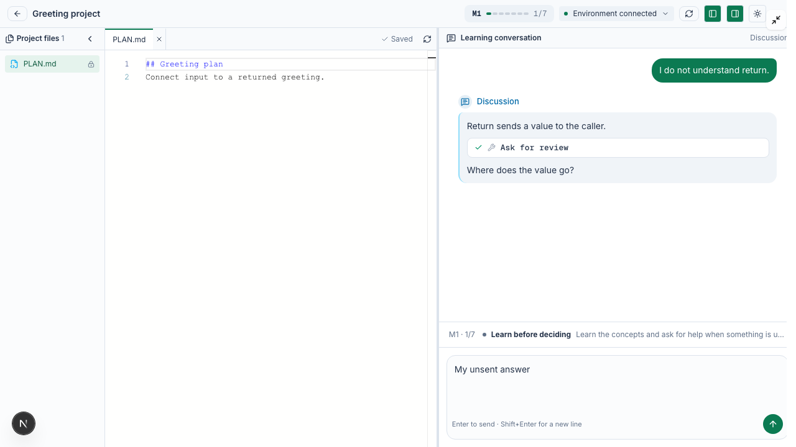
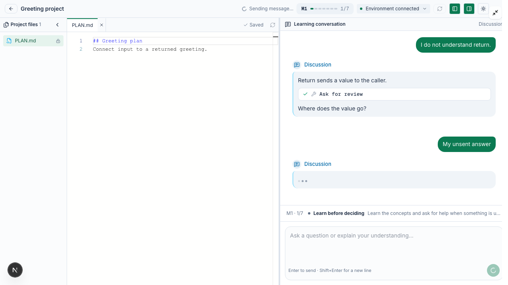
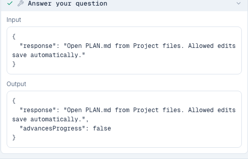

# Product-aware teaching and assistance

The shared teaching runner combines three existing layers: role-scoped course
materials, authoritative orchestration state, and registered tools. Product help
uses those same layers; it does not add another teaching step, shared role memory,
requirements panel, or general-purpose support Agent.

## Where the instructions live

| Responsibility | Source |
| --- | --- |
| Shared product facts, role responsibilities and answer boundaries | [product-context.ts](../../server/pbl-v3/product-context.ts) |
| Prompt assembly, assessment/repair context and per-request live state | [teaching-prompt.ts](../../server/pbl-v3/teaching-prompt.ts) |
| Project welcome, milestone opening, pacing and assessment rules | [skills.ts](../../server/pbl-v3/skills.ts) |
| Built-in progressive teaching, plan, code and recap sections | [teaching-sections.ts](../../server/pbl-v3/teaching-sections.ts) |
| Bound course Skills/documents and source permissions | [project-package.ts](../../server/pbl-v3/project-package.ts) |
| Tools, observations and atomic teaching receipts | [runner-tools.ts](../../server/pbl-v3/runner-tools.ts) |
| Review, current-version approval and assistance state | [guided-review.ts](../../server/pbl-v3/guided-review.ts) |
| Durable assistance input exclusion and response display | [review-question.ts](../../server/pbl-v3/review-question.ts) |

`learner-actions.ts`, `edit-access.ts` and `presentation.ts` supply the existing
transition gates, editing policy, task-drawer availability and disabled workbench
features to both the learner view and Agent guidance. These projections do not
grant authority. Host tools still enforce permissions, versions and completion.

The product guide is included once in the system prompt, with localized labels and
minimal control locations. Before each model request, the runner rereads persisted
study/evaluation, completion and environment state, enforcing stage/environment and
worker-lease fences. Only changing facts are appended as live context: task
contents, available actions and learner chat support, stage editing permissions, pending evaluation,
recorded environment readiness, registered tools and files actually observed in
this turn. A file list is marked complete only after a successful list operation, and loses
that completeness claim if an external study revision changes. File paths and
contents remain observations from past tools, not a live filesystem or screen feed;
the Agent must reread before claiming current contents or writing by hash. Changes
while a model request is generating are only observed at the next request boundary.
The Agent cannot see pane visibility, selected tabs, viewport or neighboring
classroom scenes. It must describe named controls conditionally, rather than
claiming to see the learner's screen. Environment readiness is a recorded
observation, not a fresh provider inspection on every model request.

## How a turn is handled

- Project welcome stays inside the first teaching step. It introduces the project,
  first milestone and learning format, then asks readiness once. Background/product
  questions preserve that readiness question. They do not start formal teaching.
- Every formal milestone opening describes the outcome before teaching concepts,
  avoids repeated explanations, and ends with one recorded question.
- Normal teaching/review uses the existing Skill and current-version evidence
  protocol. A mixed turn containing an actual review answer plus a help request
  can answer the help request and use that actual answer through normal review tools.
- An assistance-only turn in a guided step uses `respond_to_learner`. The same
  atomic handoff mechanism records its response and ends the turn. It preserves
  the pending review, section, coverage and approval. Its source input remains in
  conversation/report history but is excluded from later understanding/approval
  candidates. Recovery recognizes the committed receipt without generating again.
  Replies retain their durable learner-input and model-message identities across
  worker attempts. Synthesized handoff echoes are removed from the live transcript,
  merged history pages and report evidence without merging different learner turns.
- Decision discussion and existing Coder repair chat after test failure answer help
  directly when the host actions include chat. Ordinary test/quiz steps hide the
  composer and reject chat; they introduce controls without inviting messages.
  Adding ordinary assessment chat is deferred to a separate platform PR. Decisions,
  tests and quizzes still require their controls; help does not create another
  oral review gate or reveal quiz answers.
- Where chat is supported, project-related conceptual questions can go beyond the current Skill question.
  Unrelated requests are redirected briefly. Missing/ambiguous UI information calls
  for an explicit uncertainty statement and necessary clarification, not an invented
  button, tool result or staff notification.

The model still judges whether a natural-language turn is assistance-only or mixed.
The host guarantees the consequences of a committed assistance receipt; it does not
claim to perfectly classify arbitrary learner language. Assistance cannot be
committed after advancing a section in the same turn. A misclassified mixed input
is conservatively excluded; the learner must clarify/restate it. Do not silently
re-credit assistance inputs or weaken current-version approval. Check ambiguous
mixed messages with real models during course acceptance.

## Requirements, contracts and assertions

An authored contract describes required behavior and interfaces. Explain relevant
parts as the learner's task, observable outcomes and constraints. Do not imply the
learner wrote that authoring material or must edit it. A technical term can be
introduced with an explanation when it helps the task.

Evaluation assertions check behavior. Private tests, expected outputs, answer keys
and rubric preferences remain evaluator/author inputs, not student-editable files
or a shortcut to a pass. Public examples and ordinary programming assertions may
be discussed when relevant. A build pass, test pass, understanding, approval,
autosaved file and project completion are distinct records.

Skill/tool/thinking cards keep their existing expandable presentation. Returned
Skill sections and reference documents are therefore learner-visible. A document
being absent from the IDE does not make it secret. Do not place private answers in
those payloads, or require a tool card as a substitute for a requirements panel.

## UI verification

The Chromium fixture holds the chat POST response while checking immediate local
feedback. These are actual component screenshots with mocked teaching commands,
not a live course or a comparison against a historical build.

| Before sending | Immediately after sending, before HTTP acknowledgement |
| --- | --- |
|  |  |

If a send fails while the learner has typed a newer draft, both texts are restored
visibly in the composer before another send can replace the pending record. An
explicit retry of the original command leaves the newer draft in place; a late
acknowledgement removes only untouched recovered text. Recovery never replays a
request automatically.

The existing expandable tool card names assistance clearly:

## FS content PR checklist

These are course-specific follow-ups, not requirements to redesign the shared host:

1. **Course structure and starts.** Supply the independent introductory course and
   four FS project courses. Give each its own Hero metadata and final PBL scene.
   The introductory course explains the activity, programming basics and learning
   format, with an unrelated minimal practice project. The four FS courses cover
   layering/interfaces, session state/concurrency, persistence, and simplified
   fault tolerance/resource budgets. Put the relevant prerequisites in preceding
   scenes, sized for learners who may have no programming experience.
   Each project must start from its authored starter snapshot; later projects use
   the preceding projects' correct baseline, regardless of a learner's other
   attempts. Each internal milestone keeps the supported seven-step sequence.
   Release order must not become a prerequisite requiring learners to complete
   earlier projects first. Keep project identity and completion records distinct
   for participation tracking; promotion/rewards are outside this teaching change.
2. **Student-facing requirements.** For every milestone, write a concrete outcome,
   visible behavior, required interfaces and necessary constraints. Decide which
   explanations belong in preceding scenes, the opening, or an intentionally
   visible source/document. Agent reference documents are not automatically IDE
   files. Do not invent a contract/assertion drawer or ask learners to edit tests.
3. **Every bound Skill and reference.** Inspect root Skills, all progressive sections,
   role prompts, stage instructions, reference documents and starter comments.
   Delete stale UI locations, terminal/preview commands, manual setup/checkpoint
   instructions and duplicate openings/questions. Keep project welcome separate
   from formal milestone teaching, and credit already demonstrated understanding.
   Course instructions must not contradict the shared product/assistance policy.
4. **Role scope and evidence.** Bind the appropriate material to each stage/role.
   Keep discussion neutral about choices, Planner focused on PLAN.md, Coder on
   permitted source, and Mentor on recorded assessment/reflection evidence. Check
   reading permissions, source roots and cumulative PLAN update modes. Do not
   bridge private role conversations or substitute readiness/help for approval.
5. **Assertions and teaching causality.** Derive checks from observable requirements,
   accept legitimate alternative implementations/wording, and ensure relevant
   decisions have real implementation consequences. Test claims such as interrupted
   writes and process restart with those actual conditions. Include negative cases
   and public failure categories that let learners understand what to repair,
   without exposing expected answers. Check the business UI displays intended
   fallback responses rather than silently dropping them.
6. **Runtime and fixtures.** Pin the chosen project's JDK, dependencies, source tree,
   entrypoints and deterministic fixtures; verify the prepared template actually
   supplies them. Exercise builds, formal tests and repair through the public
   host path. Distinguish learner implementation failures from dependencies,
   fixtures and provider failures. Do not add guessed platform workarounds to Skills.
7. **Materials and package audit.** Keep private evaluation descriptors, expected
   outputs and answer/rubric files out of source staging, role seeds and expandable
   Skill/tool payloads. Verify exported/imported packages and role bindings. Check
   the complete authored model input against the selected model's actual capacity
   during real FS integration; do not add arbitrary teaching reply/tool/time limits.
8. **Acceptance conversations.** Where chat is supported, test all roles for absent controls, hidden
   panes, editing locks, save problems, early report requests, requirement/test
   mismatch, deep relevant questions, unrelated questions, and mixed review/help.
   Verify ordinary test/quiz steps remain controls-only and reject chat; do not
   author a task requiring learners to send messages there. Run each course from
   Hero to final report, including test failures, repair,
   current-version reapproval, re-entry and returning from the report. Confirm
   help does not restart the lesson or advance learning. Coordinate live provider
   lifecycle acceptance separately with its owner; this PR changes no reclamation
   policy.

Static policy and deterministic tool tests cannot prove every natural-language
reply or every future course. Keep representative real-model conversation checks
alongside complete course acceptance and revise any contradictory course material
at its source.

### Beta feedback: language, acceptance and editor state

All roles receive the interface locale on the queued input. A real learner turn can
establish a conversational language or an explicit preference through
`set_response_language`. Only that preference is shared across roles; their dialogue
remains isolated. Explicit preferences survive short acknowledgements, automatic
stage openings and later role changes. Interface controls use their actual localized
labels even when the conversation uses another language. Authored questions remain
course content; private answers are never exposed for translation.

A learner can accept the unchanged plan/code during an earlier review without using
a required approval keyword. `artifactApproved` carries the model's semantic assessment
of that actual reply; the host still checks its sequence, pending task, stage and
artifact fingerprint. Understanding alone, assistance, mixed acceptance/change
requests and approvals of a different version are insufficient. Earlier acceptance
is visible in the teaching context so the final section can reuse it.

Learner prose explains choices and results rather than internal section labels,
decision IDs, hashes or build revisions. Full Skill, tool and thinking cards remain
expandable. Public option labels/summaries accompany chosen IDs in downstream role
context, preserving the selected technique as well as its observable output.

The editor displays a persistent read-only reason separately from save status.
Testing, assistant work, release, recovery and inactive environments remain distinct.
Real workbench input still triggers the existing automatic preparation; the banner
also offers explicit restoration. Existing drafts are retained; new typing should
wait until recovery completes. These notices do not buffer or replay keystrokes.

Updated built-in samples have new versions and three quiz questions per milestone.
Existing references retain their previous authored content and quiz attempts. Course
package changes likewise require a new package version and a fresh learner copy
when the author wants a clean acceptance run.
