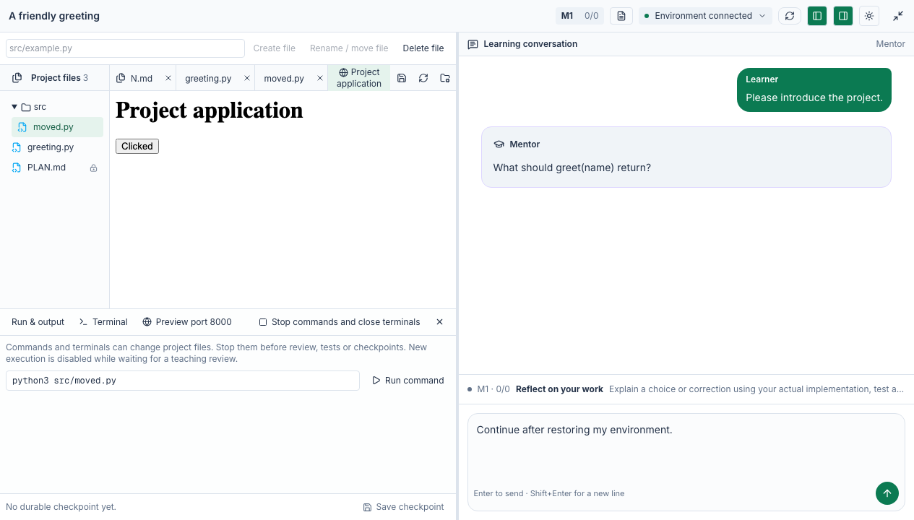

# Learning workbench and recovery

The classroom workbench reuses the existing SandboxService, owner identity, PostgreSQL
receipts, command supervisor, PTY and isolated preview gateway. There is no additional
runtime, queue, scheduler or SSH provider.

## Controls and boundaries

- Read and edit project text files. Create, rename/move and delete files only under
  trusted source directories; retain PLAN.md and refuse stale content hashes,
  traversal, symlinks and nonregular files. The public Python sample additionally
  allows sources below `src/`. Changes invalidate dependent evidence before I/O.
- Run commands and connect to a terminal during editable code stages. Planning and
  pending guided reviews do not permit arbitrary execution. Command/terminal
  creation invalidates earlier evidence; it does not claim the command passed a test.
- Stop commands and close terminals independently of the study lock or progress
  revision. Managed writers must settle before a review snapshot, test or checkpoint.
  Unknown command outcomes remain unknown; do not start a replacement automatically.
- Preview deployment-approved ports through the existing isolated gateway. Signed
  tickets bind owner, study, environment, port and revocation epoch. Each gateway
  authorization checks the current study/environment and stage again. Old generic
  sandbox tickets cannot reopen learning workspaces.
- Preserve dirty editor text when the environment changes; saving it is disabled
  until the learner copies or explicitly discards/reloads it. Late file responses
  cannot become the contents of another file.
- Save checkpoints explicitly and display the latest durable save time. Preparation
  restores the latest checkpoint using the existing allocation identity and recovery
  result. Closing a terminal panel only disconnects the view; **Stop commands and
  close terminals** ends the managed processes.

Shell access is a cooperative learning facility, not a malicious-code security
boundary. It can edit PLAN.md or start untracked background children. Code completion
refuses a changed approved plan; unchanged approved content remains valid. Do not
claim process-level isolation or save consistency while unmanaged children write.
The existing provider remains responsible for isolating different learner sandboxes.

`GET/POST /api/pbl/v3/workspace` and the owner-checked terminal stream are the dedicated
learning routes. Generic sandbox mutation APIs remain blocked for learning workspaces.
Reads show up to 20 recent/active commands; stop inspects the service's bounded command
and terminal lists. This is a workbench, not an operational audit dashboard.

## Browser fixture

The classroom workbench below uses local API fixtures, not a live cloud sandbox.



## Deployment

Follow [shared sandbox configuration](../../server/sandbox/README.md). Keep the existing
`DATABASE_URL`, agent model authorization and `OPENMAIC_AGENT_RUNTIME_ENABLED=true`.
Use the existing sandbox settings, with Python 3/POSIX shell in the code template.
A Java course also needs its JDK/build tools installed in that template. Do not put
provider credentials or private course materials in a scene or learner filesystem.

Durable checkpoints require the existing asset-byte storage configuration. Browser
preview additionally needs `OPENMAIC_APP_ORIGIN`, `OPENMAIC_SANDBOX_PREVIEW_ORIGIN`,
`OPENMAIC_PREVIEW_GATEWAY_KEY`, stable `OPENMAIC_SECRET_KEY`, DNS/TLS and the existing
`sandbox:preview` gateway process on an isolated site. Installed projects declare
`previewPorts` (default 8000); browser input cannot authorize other ports. Preview
configuration being present is not proof that its networking works.

Keep `maxActive` / `maxActivePerOwner` and PG pool sizing appropriate to the deployment.
A local test holds one learner's lock while concurrent requests receive busy responses,
then verifies another learner and ordinary SQL still proceed. This is bounded admission
validation, not a production capacity claim or a substitute for staged load testing.

Background polls and teaching tools recheck the durable environment check time before
renewing. An environment-lock conflict retries only the keepalive, at 50 ms intervals
for up to five seconds, without retaining a SQL connection while waiting or replaying
the teaching action. Provider failures, pool-admission limits and workspace mutation
conflicts still fail normally. Replaced environments cannot receive an old check receipt.

## Verification

```sh
PG_CONTRACT_URL=postgres://... pnpm exec vitest run tests/pbl/v3 tests/sandbox --maxWorkers=4
pnpm exec playwright test e2e/tests/pbl-v3-workspace.spec.ts
```

The PG tests use actual host service/store logic with a local provider fixture and
Python execution: file mutation, ownership, command results, terminal input/closure,
preview grants/revocation, checkpoint restoration and multi-learner lock pressure.
The renewal regression holds a poll inside the provider while a leased teaching tool
contends for the same real PG lock, then verifies that both complete with one renewal.
Focused tests also cover the retry budget, stale snapshots, provider failure and
environment replacement before/during a check.
The file-operation tests execute the adapter's actual Python script, including stale
hashes, occupied destinations, symlink ancestors and multiply linked files. Browser
fixtures cover dirty/stale buffers, command controls and interactive iframe preview.
They do not call a live model or provision cloud sandboxes.

Combine with the learning-experience change for Java/Python cross-milestone acceptance:
edit → run → stop → save → review → tests → next milestone → restore. Check source
fingerprints and stage evidence together, including arbitrary-command edits of PLAN.md.
Live-provider preview/PTY and small-cohort capacity must be verified on an authorized
test deployment before claiming operational readiness.

Both feature branches build on the shared workspace-contract PR. After that parent
merges, retarget to `integration/shared-sandbox`, update baselines and repeat combined
checks. Teaching Skills, version-aware assessment, reports and cross-milestone recovery
are the companion learning change; full private-course deployment and activity
operations follow the general capability work.
